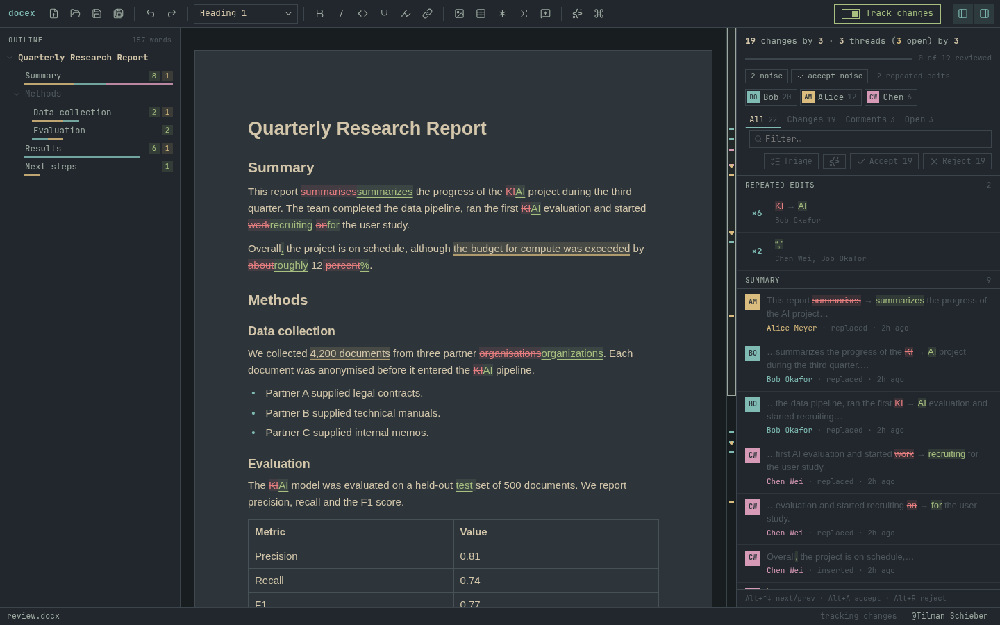
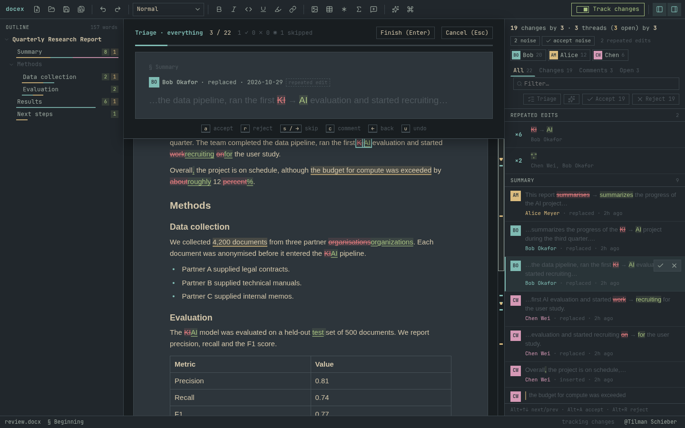
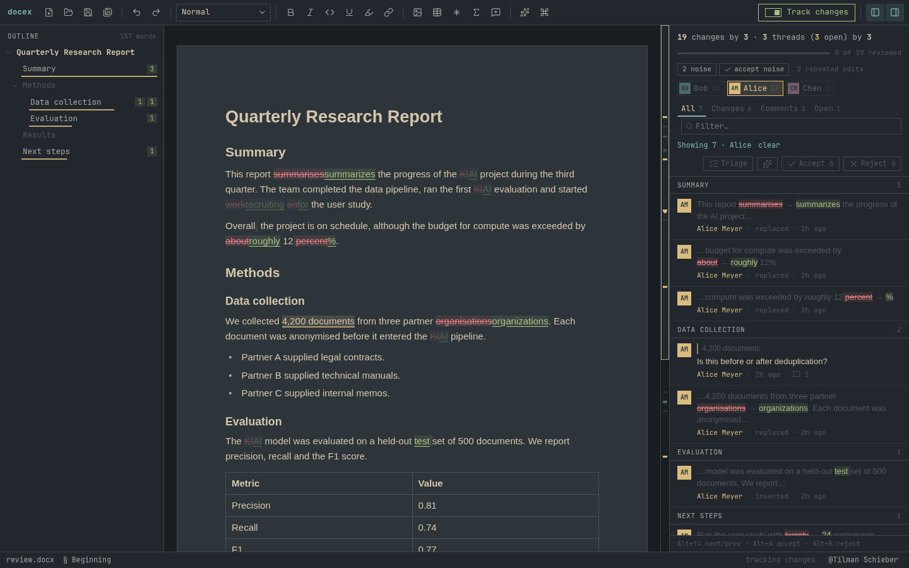
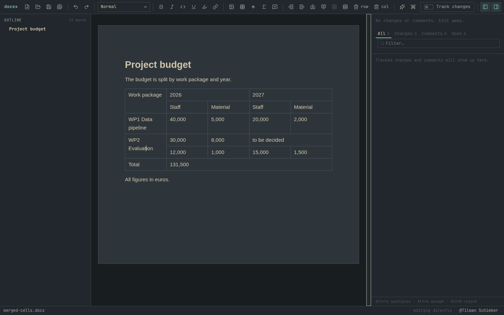
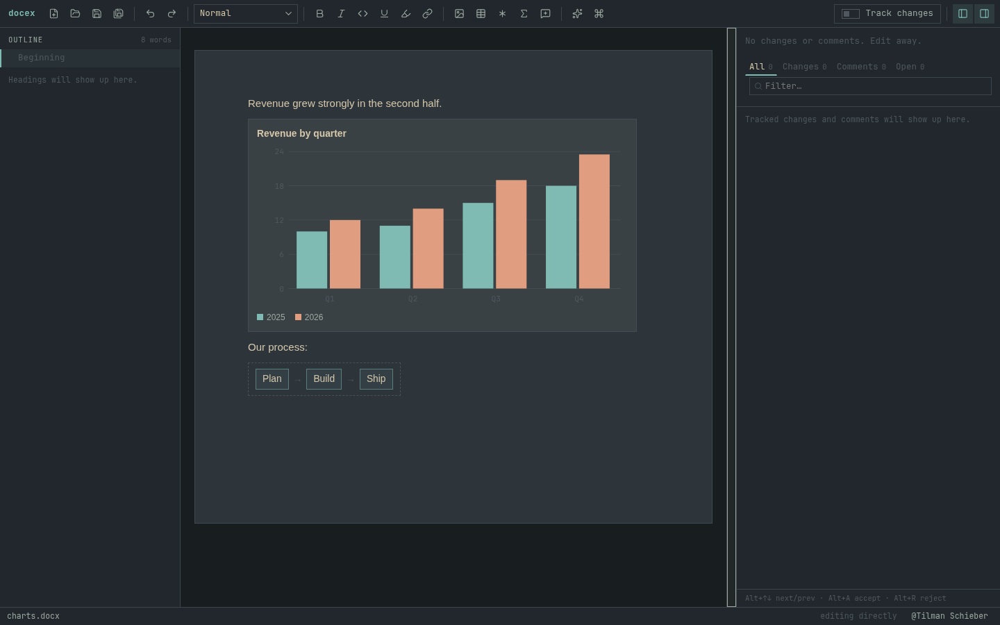

# docex

Word documents are where a lot of real work happens: contracts, reports, proposals, anything that goes back and forth between people with tracked changes and comments. docex lets you work on that content in plain text, from the terminal, an editor of your choice, a desktop app or an AI agent, without anyone on the other side noticing that you never opened Word.

The idea is simple: **the .docx stays the source of truth.** docex shows you the document as Markdown, you change what you want, and docex writes only those changes back into the original file, as Word's own tracked changes and comments under your name. Everything it doesn't touch (styles, layout, fields, headers, whatever else is in there) stays exactly as it was. Your colleagues get back the same document, with your edits in it, and review them in Word as usual.

There are three ways in: the `docex` command line, a [desktop app](#desktop-app) built for reviewing, and [instructions for AI agents](AGENTS.md).



## Quick start

```sh
cargo build --release                 # target/release/docex
target/release/docex cat report.docx  # read it as Markdown
target/release/docex edit report.docx # change it in $EDITOR; edits land in the .docx
```

## Command line

The CLI covers the whole round trip: read the document, edit it, and handle the review.

```sh
docex cat report.docx                 # Markdown, changes and comments as CriticMarkup
docex edit report.docx                # edit in $EDITOR, saved back into the .docx
docex apply report.docx edited.md     # the same from a file, e.g. one an agent wrote
docex review report.docx              # every change and comment thread, by section
docex resolve report.docx --accept c4,c9 --reject c7
docex comment report.docx --on "quoted text" "Please check this"
docex diff a.docx b.docx              # what changed between two versions
docex new notes.md -o notes.docx      # a new document from Markdown
```

Edits follow the document's own Track Changes switch, as in Word: with it on, they become word-level tracked changes in your name; with it off, they're applied directly. Either way the file keeps a `~` backup.

## How a document looks in Markdown

Headings, lists, emphasis, links, footnotes, images, captions and equations map to the Markdown you'd expect. Tracked changes and comments use [CriticMarkup](https://github.com/CriticMarkup/CriticMarkup-toolkit) (`{++added++}`, `{--removed--}`, `{==text==}{>>comment<<}`), so you can also write suggestions and comments by hand. Where Markdown runs out, docex uses a bit of HTML: tables with merged cells, underline, highlighting and colour.

Things docex can't or shouldn't edit (a table of contents, shapes, charts, headers and footers) appear as clearly marked placeholders. Charts come with their data, so figures quoted in the text can be checked against them. Leave a placeholder alone and the content survives; delete it and it's deleted.

Fonts, spacing and page layout are deliberately left out. New text takes on the formatting around it, so additions look native in Word.

## Desktop app

`gui/` is a desktop editor on the same core. It shows the document formatted, with tracked changes, comments, tables, charts and footnotes, and you can type in it like in any word processor. On save, your edits go back into the original file the same way the CLI's do.

Its focus is the part of working with Word documents that takes the most time: **going through other people's changes.**

- **See where the changes are.** An outline shows changes and comments per section; a review feed lists them with context; each person gets a chip, and filtering to one person fades out everyone else's edits.
- **Decide quickly.** Accept or reject one change, everything by one person, everything in a section, or the same edit made in forty places at once. Triage mode walks through them one at a time with single keys. Every decision can be undone.
- **Keep track.** A progress bar shows how much you've reviewed; when you're done, docex writes a summary of what you took and what you didn't to paste into your reply. A tab lists the comment threads waiting on you.
- **What's new since last time.** docex remembers each version you've seen and highlights what's different, even when the others didn't track their changes.
- **Write as well as review.** Markdown shortcuts while typing, equations, find and replace, spell checking, and an optional AI assistant that suggests rewrites as tracked changes.

<table>
<tr>
<td></td>
<td></td>
</tr>
<tr>
<td></td>
<td></td>
</tr>
</table>

```sh
cd gui
npm install
npx tauri dev -- -- path/to/file.docx   # run from source
npx tauri build --no-bundle             # binary: target/release/docex-gui
```

## AI agents

docex gives an agent the same access a person has: it reads the document as text, gets every change and comment with a stable id, decides them in one call, and writes its own edits and comments back as tracked changes under the user's name, for a human to review. [AGENTS.md](AGENTS.md) is the guide to hand an agent.

## Building and testing

```sh
cargo build --release
cargo test
cd gui && npm test && npm run e2e       # GUI unit tests; clicks and keys in headless Chromium
npm run screenshots                     # regenerate docs/screenshots/
```
